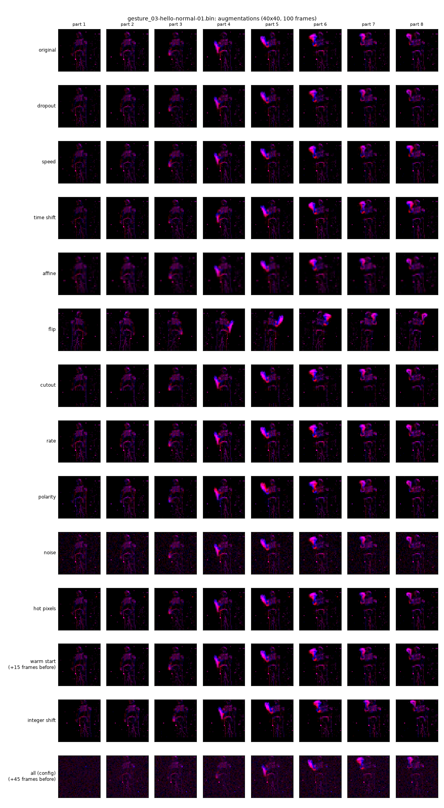

# Data augmentation

Our first model learned the 10 training people almost by heart: 98–99 % train accuracy, but only 56–63 % on the two test people. It also confused *dance* with *sit*. The robot will be worse still: other people, another camera height and distance, other lighting and camera settings, and an FPGA that never resets its potentials ([fpga-debugging.md](fpga-debugging.md)).

Augmentation changes every training clip a little, at random, each time it is used. The network then has to learn the gesture, not the exact pixels of the 2,700 training clips.

Code: [`training/snn/augment.py`](../training/snn/augment.py). Settings: the `augment:` block of a config ([`training/configs/motion_buddy_40_aug.yaml`](../training/configs/motion_buddy_40_aug.yaml)).

## How it works

- **Training batches only.** Validation, test and the fixed-point check always see the real clips.
- **On the GPU, on the cached event counts** `[B, T, 2, 40, 40]` (events per downsampled pixel per 10 ms frame), before they are encoded (`mean` / `sum` / `binary`). The cache stays as it is, and a batch takes milliseconds.
- **Off by default.** Every augmentation has a probability `p` per clip (warm start: per batch) and a strength. `p: 0` turns it off. Old configs and old runs train exactly as before.
- **Float and QAT phases both** (`augment.qat: true`), so QAT fine-tunes on the same distribution.
- **Fixed order:** scene changes first, sensor effects last:

```
dropout → speed / time shift → zoom + rotation → flip → integer shift → cutout → rate
        → polarity → noise / hot pixels → warm-start prefix → encode
```



*One clip (person 01, "hello"), each augmentation alone at full strength, then the whole config. Every column sums 12–13 frames; red = ON events, blue = OFF events. Make your own with `uv run --group train scripts/view_augment.py <clip.bin> [--config ...] [--save out.png]`.*

## The augmentations

| Name (config key) | What it does | Robot problem it targets | Default in `motion_buddy_40_aug` |
|---|---|---|---|
| **shift** (`data.max_shift`) | Moves the clip by up to ±N whole pixels (exact, zero fill) | The person stands somewhere else in the image | ±4 px (notebook: ±2) |
| **affine** | Zoom 0.8–1.2× and rotation ±10° per clip, bilinear | Distance to the dog; camera tilt when the dog moves | p 0.5 |
| **flip** | Mirror left/right | Waving with the other hand | off |
| **time_shift** | Gesture starts up to ±20 frames (200 ms) earlier or later; empty frames fill the gap | On the live stream the gesture isn't aligned with a 1 s window | p 0.5 |
| **speed** | Plays the clip 0.8–1.25× as fast | People gesture at their own speed | p 0.5 |
| **dropout** | Removes up to 30 % of the events (binomial thinning) | Sparser scenes, stronger noise filter, lower contrast | p 0.5 |
| **rate** | Multiplies all counts by 0.7–1.3 | Lighting and camera bias settings change the event rate | p 0.5 |
| **noise** | Adds random background events: up to 0.3 per pixel per frame (Poisson) | Sensor noise; the real median is ~1 event per pixel per frame | p 0.5 |
| **hot_pixels** | 1–2 pixels that fire 2–20 events every frame | Every sensor has some; the dataset has one at (128, 231) firing ~21/frame | p 0.3 |
| **cutout** | Blanks a random rectangle (20–40 % of the side) in every frame | Something in front of the person, arm leaving the image | off |
| **polarity** | Swaps the ON and OFF channels | Dark clothes on a light background vs the opposite | off |
| **mixup** | Blends two clips of the batch, x = λ·a + (1−λ)·b with λ ~ Beta(0.4, 0.4), and blends their spike-count targets the same way (fits the MSE-on-counts loss). Per batch, applied last | Gives graded rather than overconfident outputs between classes; a regulariser rather than a robot problem | off (`motion_buddy_40_v3`: p 0.5) |
| **warm_start** | Puts 10–50 frames in front of the clip. Half the time they are the end of another clip, half the time empty. Only spikes after them count for the loss | **The FPGA never resets its potentials**, so on the robot each gesture starts from what came before | p 0.5 (per batch) |

Flip, cutout and polarity are off in the main config. They are plausible, but for flip and polarity it's unclear the real camera needs them, so the `extras` ablation tests them first.

### Details worth knowing

- **Speed and time shift integrate the events; they don't copy frames.** Output frame *t* gets the events the clip produced in source time [τ(t), τ(t+1)), with τ(t) = centre + (t − centre)·speed − shift, interpolated on the cumulative count. No event is invented. A faster gesture has more events per frame, like a real faster movement. Slowing down pushes the ends of the clip out of the 1 s window. Counts can become fractional, so `binary` encoding uses `count >= 0.5`; on real integer counts that's the same as `> 0`.
- **Zoom keeps the event density per pixel**: a person zoomed in covers more pixels at about the same events per pixel, as when they step closer. Bilinear sampling blurs very slightly. The whole-pixel **shift** stays exact.
- **Noise strengths come from the data:** in the training cache, the median pixel gets ~1 event per frame (both polarities), the hot pixel ~21, and ON/OFF are 50/50. `noise.max_rate` and `hot_pixels.rate` are set against these.
- **Warm start** is the one augmentation about the hardware rather than the scene. The network learns not to depend on starting from zero potentials, so the classification holds when the previous gesture is still in the potentials. The prefix length is the same for the whole batch, so batches stay rectangular. The model's `forward(x, warmup=n)` skips the first *n* frames when counting spikes.

## Configuring

The `motion_buddy_40_aug.yaml` block:

```yaml
base: motion_buddy_40.yaml        # everything else from the base config
data:
  max_shift: 4
augment:
  qat: true
  dropout:    {p: 0.5, max: 0.3}
  speed:      {p: 0.5, range: [0.8, 1.25]}
  time_shift: {p: 0.5, max_frames: 20}
  affine:     {p: 0.5, scale: [0.8, 1.2], rotate_deg: 10}
  flip:       {p: 0.0}
  cutout:     {p: 0.0, size: [0.2, 0.4]}
  rate:       {p: 0.5, range: [0.7, 1.3]}
  polarity:   {p: 0.0}
  noise:      {p: 0.5, max_rate: 0.3}
  hot_pixels: {p: 0.3, max_count: 2, rate: [2, 20]}
  warm_start: {p: 0.5, frames: [10, 50], from_clip: 0.5}
```

- **`base:`** (new) inherits another config and overrides only what's listed. Nested blocks merge; lists replace. The run folder's `config.yaml` is always the fully expanded config.
- Unknown keys are errors (typos don't silently do nothing). Ranges must be `[low, high]`. `check` validates everything.
- The training log's first lines show what's active: `augmentation: dropout, speed, …, shift +-4px`. `metrics.json` has the list under `"augment"`.

## Measuring what helps: ablations

Turning on everything at once doesn't show which parts help. `training/configs/ablation/` has one config per group, each 50 float epochs + 10 QAT epochs on the same seed and splits. Running 7 at once only time-slices the GPU (about 100 s per epoch instead of 9 s), so `baseline` and `all` weren't run as ablations: without a learning-rate schedule their first epochs are the same as those of the 300-epoch runs `motion-buddy-40-e300` and `motion-buddy-40-aug`.

| Config | Augmentations |
|---|---|
| `baseline` | none (±2 px shift, as the notebook) |
| `spatial` | ±4 px shift, zoom + rotation |
| `temporal` | speed, time shift |
| `camera` | dropout, rate, noise, hot pixels |
| `warm_start` | warm start only |
| `all` | the full `motion_buddy_40_aug` set |
| `extras` | the full set + flip, cutout, polarity |

```bash
for a in baseline spatial temporal camera warm_start all extras; do
  remote/train.sh training/configs/ablation/$a.yaml abl-${a//_/-}
done          # all fit on the A100 at once (~3 GB each)
```

Compare the **fixed-point** accuracies in each `runs/abl-*/metrics.json`, and watch two things:

- **The test set is only 2 people (~1,000 clips).** Differences of 2–3 points are within noise.
- **Augmentation makes training harder.** Train accuracy drops, and the network may need more epochs to reach its best validation accuracy. A 50-epoch ablation underestimates it a little.

## Results

Fixed point = the 8-bit model as on the FPGA. Test = persons 13 and 14, who are recorded differently from everyone else (several people in the frame, off-centre subject, a moving distractor); see `scripts/eval_per_person.py`.

| Run | Float val / test | Fixed point val / test |
|---|---|---|
| `motion-buddy-40-v1` (30 epochs, no aug) | 73.3 / 57.1 | 75.2 / 56.0 |
| `motion-buddy-40-e300` (300 epochs, no aug, Q2.6 + QAT) | 77.6 / 62.9 | 78.0 / 60.0 |
| `abl-spatial` (50 epochs) | 78.6 / 65.4 | 72.5 / 60.7 |
| `abl-extras` (50 epochs, everything + flip, cutout, polarity) | 74.9 / 59.6 | 74.9 / 62.9 |
| `abl-warm-start` (50 epochs) | 78.0 / 54.2 | 79.1 / 57.7 |
| `abl-temporal` (50 epochs) | 72.9 / 53.9 | 74.9 / 57.3 |
| `abl-camera` (50 epochs) | 72.5 / 57.3 | 70.6 / 59.3 |
| `motion-buddy-40-aug` (300 epochs, full set, Q3.5 + QAT) | 84.0 / 70.3 | 82.1 / 66.3 |
| `motion-buddy-40-aug-lsA0` (same float model, per-layer scaling Q1.7, no QAT) | 84.0 / 70.3 | **83.2 / 67.9** |

- Augmentation is the big win: +7 test points in float. Per person, test person 13 went 71 → 78 % and person 14 50 → 62 %; *dance* recall 32–44 → 93 %. *Sit* for the off-centre person 14 is still weak.
- Spatial augmentation helps test most among the groups; temporal and camera augmentation show no gain on these test people (they differ in framing and clutter, not timing or sensor).
- With 2 test people, ±2–3 points is noise.

## Related fix: NaN in QAT after long training

The 300-epoch run without augmentation trained fine. QAT then went NaN: the network went silent (val loss exactly 16.0 = all-zero output, since a NaN potential never crosses the threshold) and the export reported every weight as "clipped". Two fixes were needed, because the first rested on an incomplete diagnosis:

1. **First look:** 32 of the 256 layer-3 BatchNorm scales γ had shrunk to ~5·10⁻⁴¹ (denormal floats) during float training. riverops' fusion-aware QAT divides by the folded scale γ/√(var+ε), and its gradient by the scale squared, which overflows. Zeroing those γ once before QAT (riverops treats an exact 0 as a special case) only moved the failure: QAT ran three good epochs, then went NaN in epoch 4.
2. **Traced** (`scripts/fpga_debug/qat_nan_trace.py` checks every gradient before clipping): step 312, `net.3.bn.weight[140]`, γ = 2.3·10⁻¹³. The real mechanism is **channels whose input never changes**. Their running variance is ~0 and their normalized output is always 0, so the loss gives their γ no gradient. Only weight decay acts on it, and shrinks it smoothly towards 0. Channel 140 was above the 10⁻⁶ cutoff at the start of QAT and became tiny *during* QAT. One inf gradient turns every weight into NaN through gradient clipping, which divides by the total norm.

The pipeline now:
- sets every γ with |γ| < 10⁻⁶ to exactly 0, **before QAT and after every QAT step** (`zero_tiny_gammas` in `train.py`). It changes no outputs: such a channel outputs its BN bias whatever γ is. Above 10⁻⁶ the gradient stays finite (≲10¹⁴, float32 goes to 3·10³⁸);
- after each training epoch, checks every parameter and stops with the parameter's name if any is non-finite. A NaN shows up as a silent network, not in the loss, so a loss check alone misses it.

To redo only the quantization part of a run from its `float_best.pt`, use `remote/qat.sh <run>` on the server, or `python -m training.snn qat --run-dir runs/<run>` locally.
